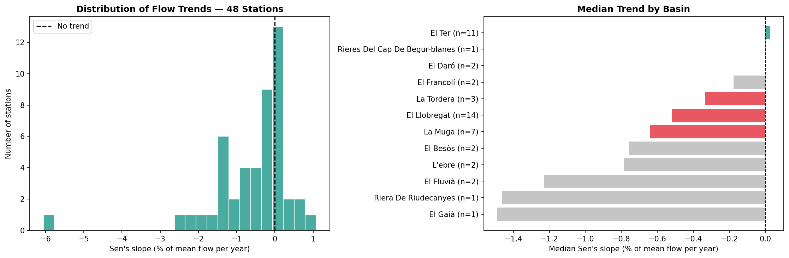
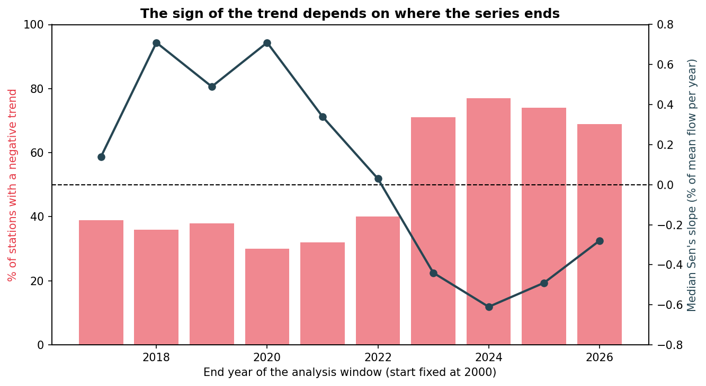
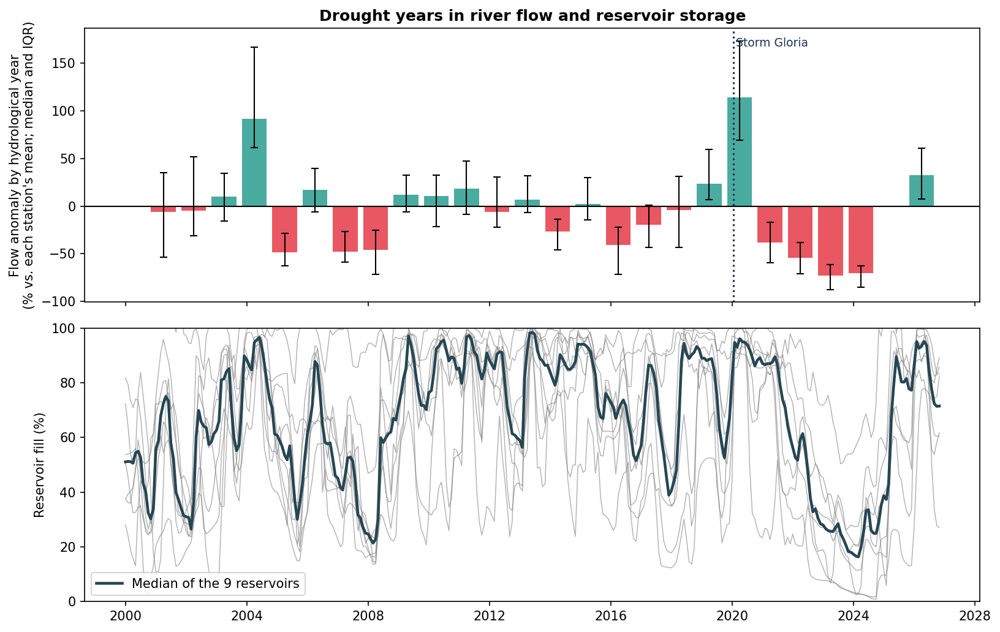
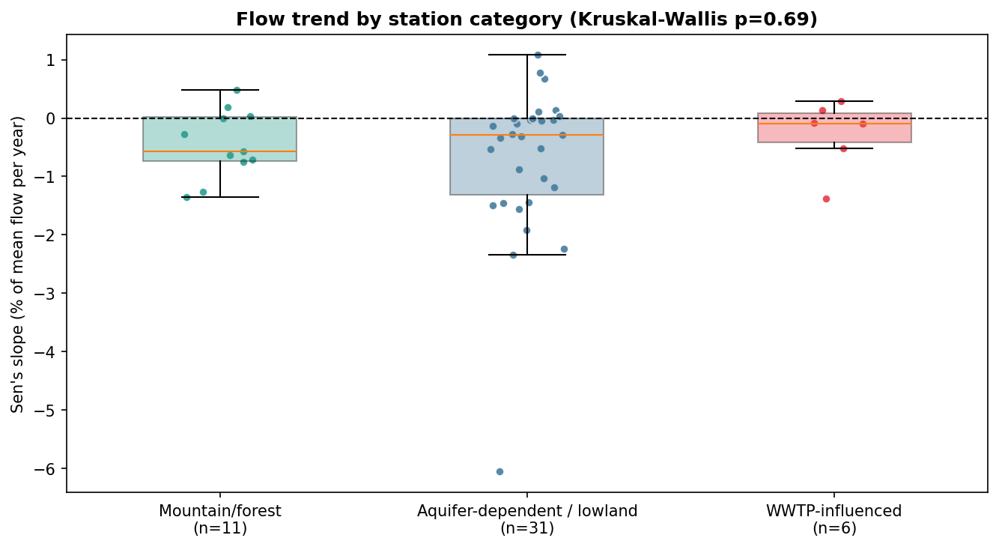

# Surface Water Flow Trends — Internal Basins of Catalonia

> **ACA Open Data · Mann-Kendall · Sen's slope · Drought · Storm Gloria · Reservoirs · Folium Interactive Map**
> Independent analysis using public data from the Catalan Water Agency (ACA)

---

## Project Description

This project analyzes how **river flows have changed in the internal basins of Catalonia between 2000 and 2026**, using the daily records of the gauging network of the Catalan Water Agency (ACA). Its aim is not only to estimate trends, but to test **how robust those trends are** to the choice of stations, the statistical method and the analysis window.

The comprehensive analysis includes:

1. **Automated API Download** — Daily flow records, wastewater treatment plants (EDAR) and reservoir volumes, retrieved directly from the ACA open data portal.
2. **Data Cleansing & Validation** — Explicit date parsing, discharge-only records, physical range filters and station quality controls (minimum time span, coverage and maximum data gap).
3. **Trend Analysis per Station** — Mann-Kendall test and Sen's slope on monthly means, expressed as a **percentage of each station's mean flow per year** so that rivers of different sizes are comparable. The autocorrelation-corrected version of the test (Hamed-Rao) and false discovery rate control are applied.
4. **Overview** — Trneds across the network.
5. **Data quality and coverage** —  Check which stations were excluded and why, how many stations reported data each month, and how many records are exactly zero.
6. **Robustness Checks** — Five filter scenarios, two time windows and sensitivity of the result to the end year of the series.
7. **Drought and Storm Gloria** — Flow anomalies by hydrological year next to reservoir storage, and how exceptional the January 2020 storm was at each station.
8. **Reservoir regulation** — regulated vs. natural stations.
9. **Two Explanatory Hypotheses** — Wastewater effluent and reservoir regulation, each tested with several measures and with control for river size.
10. **Interactive Spatial Mapping and summary** — Folium web map with two switchable analysis windows.
11. **Conclusions and limitations**

---

## Data Source

| Field | Detail |
|-------|--------|
| **Publisher** | Agència Catalana de l'Aigua (ACA) — Generalitat de Catalunya |
| **River flow** | Cabals dels rius a les conques internes de Catalunya (`hprm-xuw7`) |
| **Wastewater treatment** | Sistemes públics de sanejament en alta i estacions depuradores d'aigües residuals de Catalunya (`k288-dig3`) |
| **Reservoirs** | Quantitat d'aigua als embassaments de les Conques Internes de Catalunya (`gn9e-3qhr`) |
| **Update Frequency** | Daily |
| **License** | Open Data Generalitat de Catalunya |
| **Data downloaded** | 08 November 2026 |

The ACA updates these datasets daily, so figures can change slightly between runs. All numbers in this README correspond to the download date above.

---

## Main Results

| Metric | Value |
|--------|-------|
| Stations with flow data | 88 |
| Stations passing quality filters (main analysis) | 48 |
| Stations with a negative trend | 33 (69%) |
| Negative and significant (p < 0.05) | 15 (14 after false discovery rate control) |
| Positive and significant (p < 0.05) | 0 |
| Median trend (% of mean flow per year) | -0.28 |

### 1. Most stations show a decline, and this is robust to the filters

The share of stations with a negative trend is **69–70% in all five filter scenarios**, from the baseline to a relaxed one with 77 stations. In the main (most conservative) analysis no station shows a statistically significant increase; in the relaxed scenario 3 do.

| Scenario | Stations | Negative | Negative & significant | Positive & significant |
|----------|----------|----------|------------------------|------------------------|
| A: baseline (current) | 63 | 44 (70%) | 24 | 4 |
| B: + max gap 36 months | 49 | 34 (69%) | 18 | 2 |
| C: + Hamed-Rao only | 62 | 43 (70%) | 18 | 2 |
| D: both | 48 | 33 (69%) | 15 | 0 |
| E: relaxed (10-year span, 40% coverage) | 76 | 52 (69%) | 22 | 4 |

### 2. But the decline depends on where the series ends

The sign of the aggregate trend changes with the end year of the analysis window (start fixed at 2000). Up to 2022 only 30–40% of stations decline; from 2023, when the drought years enter the series, 69–77% do. The jump between 2022 and 2023 cannot be explained by the few stations that enter the sample: at least 12 stations changed sign.

| End year | Stations | % negative | Median slope (%/yr) | Negative & significant |
|----------|----------|------------|---------------------|------------------------|
| 2017 | 38 | 39% | 0.14 | 9 |
| 2018 | 39 | 36% | 0.71 | 8 |
| 2019 | 40 | 38% | 0.49 | 8 |
| 2020 | 40 | 30% | 0.71 | 1 |
| 2021 | 41 | 32% | 0.34 | 4 |
| 2022 | 43 | 40% | 0.03 | 7 |
| 2023 | 48 | 71% | -0.44 | 17 |
| 2024 | 48 | 77% | -0.61 | 18 |
| 2025 | 50 | 74% | -0.49 | 19 |
| 2026 | 48 | 69% | -0.28 | 15 |

Among the 38 stations that pass the filters in both windows, **37% decline in 2000-2019 and 66% in 2000-2026**. The *ranking* of stations is stable (Spearman ρ = 0.78): the stations that lose most in one window are the ones that lose most in the other.

### 3. Drought and wet years dominate a 26-year record

Using hydrological years (October–September) and each station's own mean as reference, the median flow anomaly was **+114% in 2020** (the wettest year of the record) and then **-38%, -54%, -73% and -70%** in 2021-2024. Earlier dry periods are also visible (-49% in 2005, -48% and -46% in 2007-2008, -41% in 2016). The nine reservoirs show the same pattern, with a median fill below 20% in 2023-2024. In such a record the interannual variability is as large as any trend, so the trend estimates should be read as describing this particular sequence of years rather than a steady long-term decline.

### 4. Storm Gloria (January 2020)

Of the 63 stations with usable data, Gloria produced the **highest daily flow on record at 32** and was among the three highest at 46. Values are daily means, which underestimate instantaneous peaks.

### 5. Data availability gap

Between September and December 2024 only **1 station** of the network published data (versus about 70–73 per month before), and throughout 2025 the network operated with 37–55 stations (29 in January 2026). The end of the drought and the start of the recovery are therefore poorly observed in the river data, although the reservoirs show a clear recovery in 2025.

### 6. Wastewater effluent: no relationship detected

Three different measures were tested against the station trends:

| Measure | Result |
|---------|--------|
| Population equivalent of WWTPs within 20 km | Spearman ρ = 0.067 (p = 0.6499) |
| Effluent design flow / river mean flow, WWTPs discharging into the same river (≤ 25 km) | Spearman ρ = 0.258 (p = 0.0771) |
| Three station categories (mountain/forest, aquifer/lowland, WWTP-influenced) | Kruskal-Wallis H = 0.737 (p = 0.6916) |

### 7. Reservoir regulation: no effect detected once river size is considered

Stations were classified as regulated (on the main stem downstream of one of the nine reservoirs) or natural. Two hypotheses were fixed before testing, with a threshold of 0.025 per test:

- **H1 — regulated stations have flatter trends:** not supported (median |trend| 0.53 vs 0.32 %/yr, p = 0.915).
- **H2 — regulated stations fall less in the 2022-2024 drought:** the raw difference (-57% vs -70%) looked suggestive (p = 0.035; between 0.024 and 0.045 across four classification variants), but it did not meet the threshold and **disappears when rivers of similar size are compared**: regulated stations are on much larger rivers (median mean flow 6.17 m³/s), and larger rivers fell less in relative terms (Spearman ρ = 0.48 between river size and drought anomaly).

| Stations with mean flow | Regulated (median anomaly) | Natural (median anomaly) | p |
|-------------------------|----------------------------|--------------------------|---|
| ≥ 0.5 m³/s | 13 (-58%) | 27 (-64%) | 0.436 |
| ≥ 1 m³/s | 13 (-58%) | 14 (-55%) | 0.903 |
| ≥ 2 m³/s | 11 (-56%) | 8 (-51%) | 0.310 |

In a regression adjusted for river size, the regulation effect is **-0.1 percentage points (95% CI -10.3 to +10.2)**: no detectable effect of regulation once river size is accounted for.

---

## Data Visualizations


*Distribution of station trends and median trend by basin (grey bars: basins with fewer than three stations)*


*The share of declining stations depends on the end year of the analysis window*


*Flow anomaly by hydrological year (top) and reservoir fill (bottom)*


*Station trends by category: no significant difference between groups*

🌐 **Interactive Map:** [Open Interactive Map](https://raw.githack.com/cdmunozs/Trends-RiverFlow-Catalonia/main/output/catalonia_flow_trends_map.html)

The map shows every station colored by trend, with a black outline for statistically significant ones, and lets you switch between the 2000-2019 and 2000-2026 windows.

**Color Legend:**
- 🔴 Strong decline (< −1 % of mean flow per year)
- 🟠 Moderate decline (−1 to −0.25)
- 🟡 Stable (−0.25 to +0.25)
- 🟢 Moderate rise (+0.25 to +1)
- 🔵 Strong rise (> +1)

---

## Limitations

- **Short record relative to climate variability.** 26 years with a severe drought at the end cannot separate a trend from the alternation of wet and dry periods.
- **Limited sample.** Only 48 of 88 stations pass the quality filters (14 are too recent, 25 have incomplete records). Several basins have one or two stations, and the Llobregat and Ter dominate the sample. Stations on the same river are not independent.
- **Data quality.** Daily means underestimate flood peaks, the network had a major reporting gap from September 2024 to early 2026, and several intermittent streams have many zero-flow days (which produces Sen's slopes of exactly zero).
- **WWTP analysis.** Design flow is a capacity, not the actual discharge, and matching by river name and distance cannot separate WWTPs upstream from those downstream of a station.
- **Regulation analysis.** The classification was built manually from river geography; "natural" means "no listed reservoir" and does not exclude small weirs or hydropower. Only four river systems contribute regulated stations.
- **Multiple analyses.** Several analyses were run during development. Hypotheses and thresholds were fixed before testing, and all analyses kept in the notebook are reported here, including negative results. An initial effluent measure based on summing WWTPs within a radius produced physically impossible values and was discarded.

**Possible extensions:** seasonal Mann-Kendall or annual-series tests, low-flow indices (Q95, 7-day minimum), station elevation, and a river network to distinguish upstream from downstream influences.

---

## Repository Structure
```
Trends_RiverFlow_Catalonia/
│
├── output/
│   ├── 01_trend_distribution.png
│   ├── 02_trend_by_category.png
│   ├── 03_end_year_sensitivity.png
│   ├── 04_drought_flow_reservoirs.png
│   ├── catalonia_flow_trends_map.html
│   └── station_trends_summary.csv
├── README.md
└── Trends_RiverFlow_Catalonia.ipynb
```

---

## How to Run the Analysis

```bash
pip install -r requirements.txt
jupyter notebook Trends_RiverFlow_Catalonia.ipynb
```

The notebook downloads the data directly from the ACA portal (an internet connection is required) and takes a few minutes to run. Use **Restart Kernel and Run All** to reproduce the analysis from scratch. To view the map locally, serve the `output` folder (for example `python -m http.server`) instead of opening the file directly, because some map tile providers block requests without a referrer.

---

## Tech Stack


---

## Hydrological Context

The internal basins of Catalonia (Llobregat, Besòs, Ter, Tordera, Fluvià, Muga and smaller coastal basins, among others) drain entirely within Catalonia and are managed by the ACA. Under a Mediterranean climate their flows alternate between multi-year droughts and wet years with intense storms, and several systems are regulated by reservoirs and receive treated wastewater. These conditions make long-term trend detection difficult and motivate the robustness checks of this project.

---

## Authors

**Carlos Daniel Muñoz Sánchez**
- Geologist · Hydrogeologist · GIS & Data Analyst
- M.Sc. Science and Integrated Water Management — Universitat de Barcelona
[LinkedIn](https://www.linkedin.com/in/danielmu95/) · [GitHub](https://github.com/cdmunozs)

---

## References

- Mann, H.B. (1945). Nonparametric tests against trend. *Econometrica*, 13(3), 245–259.
- Kendall, M.G. (1975). *Rank Correlation Methods*. Griffin, London.
- Sen, P.K. (1968). Estimates of the regression coefficient based on Kendall's tau. *Journal of the American Statistical Association*, 63(324), 1379–1389.
- Hamed, K.H. & Rao, A.R. (1998). A modified Mann-Kendall trend test for autocorrelated data. *Journal of Hydrology*, 204(1–4), 182–196.
- Benjamini, Y. & Hochberg, Y. (1995). Controlling the false discovery rate: a practical and powerful approach to multiple testing. *Journal of the Royal Statistical Society B*, 57(1), 289–300.
- Hussain, M. & Mahmud, I. (2019). pyMannKendall: a python package for non parametric Mann Kendall family of trend tests. *Journal of Open Source Software*, 4(39), 1556.
- Agència Catalana de l'Aigua (ACA). Cabals dels rius a les conques internes de Catalunya; Sistemes públics de sanejament en alta i estacions depuradores d'aigües residuals de Catalunya; Quantitat d'aigua als embassaments de les Conques Internes de Catalunya. Generalitat de Catalunya — Open Data.
